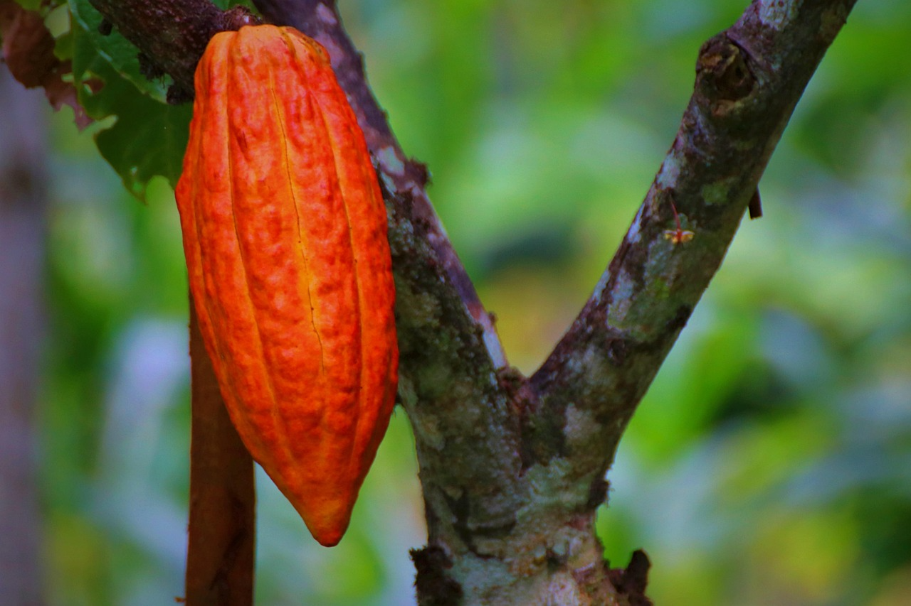

# IoT for Agriculture

Agricultural monitoring is essential for improving productivity, product quality, and resource management, particularly in rural areas with limited infrastructure. However, conventional monitoring solutions can be costly and lack real-time data access, limiting their adoption by small-scale farmers and research institutions.

To address these challenges, we developed low-cost, IoT-based systems for soil nutrient profiling, cocoa fermentation monitoring, and meteorological data collection. The systems integrate ESP32-based sensors, wireless communication technologies such as LoRa and GSM, and cloud platforms for real-time data transmission, storage, visualization, and geospatial mapping.

Field tests in El Salvador demonstrated reliable data transmission, successful georeferencing, and consistent monitoring performance. The meteorological station achieved a packet delivery rate exceeding 98%, while the cocoa fermentation system continuously monitored temperature, humidity, and pH over seven days. These solutions provide affordable, scalable, and replicable approaches to precision agriculture, agro-industrial process control, and environmental monitoring.

Art by Pixabay. Photo from Maliflac. 

## Publications

O. O. Flores-Cortez, B. Cordero, F. Arévalo, C. Pocasangre, and W. Melendez. (2026). 
["A Portable IoT-Enabled System for Georeferenced Soil Nutrient Screening in Agricultural Fields"](https://www.researchgate.net/publication/413693054_A_Portable_IoT-Enabled_System_for_Georeferenced_Soil_Nutrient_Screening_in_Agricultural_Fields). 
Engineering Proceedings, 150(1), 117. 
[doi: 10.3390/engproc2026150117](https://doi.org/10.3390/engproc2026150117).

O. O. Flores-Cortez, C. O. P. Jiménez, F. Arévalo, W. M. Valle and J. A. Díaz, 
["An IoT Architecture for Monitoring Cocoa Fermentation Parameters: A Small-Scale Case Study,"](https://www.researchgate.net/publication/412206851_An_IoT_Architecture_for_Monitoring_Cocoa_Fermentation_Parameters_A_Small-Scale_Case_Study) 
2026 6th International Conference on Electrical, Computer and Energy Technologies (ICECET), Rome, Italy, 2026, pp. 1-6, 
[doi: 10.1109/ICECET65726.2026.11633054](https://doi.org/10.1109/ICECET65726.2026.11633054).

W. D. M. Valle, C. O. P. Jiménez, O. O. Flores-Cortez, F. Arévalo, J. Angulo, G. Barahona, O. Flores, and C. Silva, 
["A Low-Cost LoRa-Enabled IoT Weather Station: A Case Study in an Aquaculture Field in El Salvador"](https://www.researchgate.net/publication/404894597_A_Low-Cost_LoRa-Enabled_IoT_Weather_Station_A_Case_Study_in_an_Aquaculture_Field_in_El_Salvador), 2025 IEEE
43rd Central America and Panama Convention (CONCAPAN XLIII), San Salvador, El Salvador, 2025, pp. 1-6,
[doi: 10.1109/CONCAPAN66820.2025.11512349](https://doi.org/10.1109/CONCAPAN66820.2025.11512349).

O. O. Flores-Cortez, A. Oviedo-Argueta, J. M. C. Rodríguez, M. R. Alvarado-Palacios, C. O. P. Jiménez, and F. Arévalo, 
["A Low-Cost IoT-Cloud-Based System for Environmental Monitoring in Poultry Farms: A Case Study in Rural El Salvador"](https://www.researchgate.net/publication/404014774_A_Low-Cost_IoT-Cloud-Based_System_for_Environmental_Monitoring_in_Poultry_Farms_A_Case_Study_in_Rural_El_Salvador), 
2025 IEEE CHILEAN Conference on Electrical, Electronics Engineering, Information and
Communication Technologies (CHILECON), Valparaíso, Chile, 2025, pp. 1-6, 
[doi: 10.1109/CHILECON66915.2025.11476124](https://doi.org/10.1109/CHILECON66915.2025.11476124).

O. O. Flores-Cortez, J. M. Castro Elizondo, A. C. Flores Portillo, F. Arévalo and C. O. Pocasangre, 
["An IoT-Based System for Water Parameters Monitoring. Case Study: Fish Farming in El Salvador,"](https://www.researchgate.net/publication/382128143_An_IoT-Based_System_for_Water_Parameters_Monitoring_Case_Study_Fish_Farming_in_El_Salvador) 
2024 IEEE International Workshop on Metrology for Industry 4.0 & IoT (MetroInd4.0 & IoT), Firenze, Italy, 2024, pp.
123-128, 
[doi: 10.1109/MetroInd4.0IoT61288.2024.10584126](https://doi.org/10.1109/MetroInd4.0IoT61288.2024.10584126).
